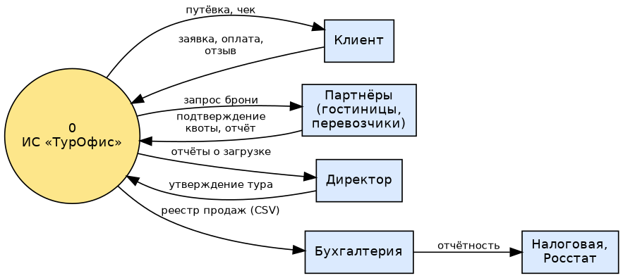
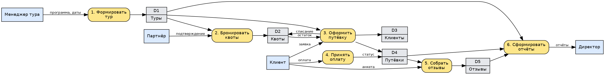
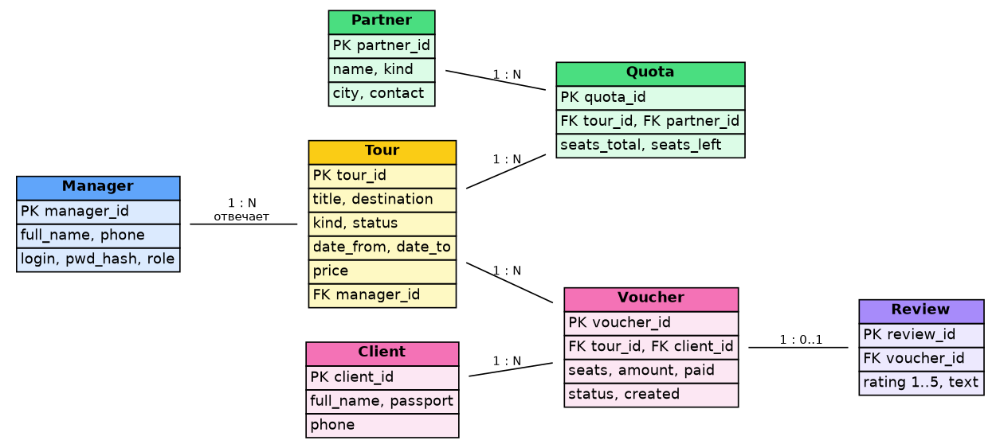
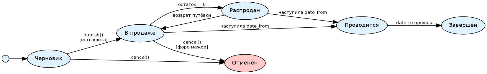
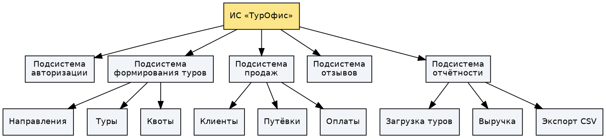
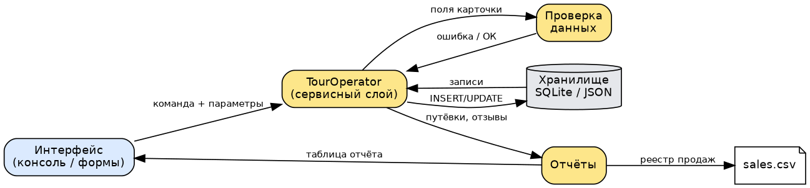
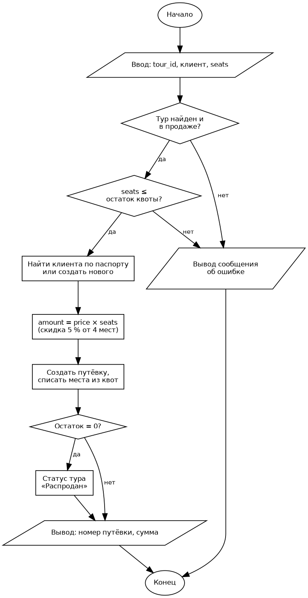
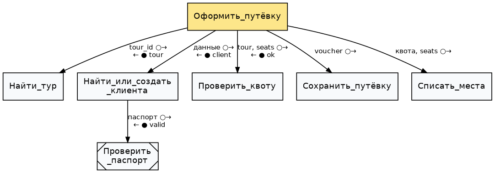
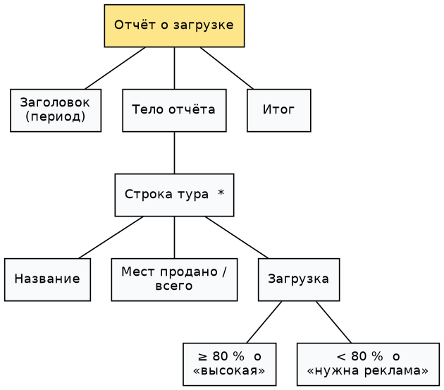

# Практическая работа №3. Построение архитектуры программного средства

## Задание №1. Эскизный проект ИС «ТурОфис»

### 1. Постановка задачи

На основе ТЗ (ПР №2) проанализировать требования, выбрать технические решения,
построить модели потоков данных и данных, составить спецификации процессов и
словарь терминов.

### 2. Анализ требований

| Группа | Требования из ТЗ | Следствие для проекта |
|--------|------------------|------------------------|
| Функциональные | F1–F12 | 5 подсистем: авторизация, туры, продажи, отзывы, отчёты |
| Надёжность | запрет продажи сверх квоты, проверка ввода | списание квоты и создание путёвки — в одной транзакции; валидация в свойствах классов |
| Производительность | поиск ≤ 2 с при 10 000 путёвок | индексы по `destination`, `date_from`, `status` |
| Совместимость | Python 3.10+, CSV/JSON UTF-8 | стандартная библиотека, модуль `csv` |
| Эксплуатация | пользователи с базовыми навыками ПК | меню с нумерованными пунктами, понятные сообщения |

### 3. Технические решения

- **Метод решения:** объектно-ориентированный (классы предметной области +
  сервисный класс `TourOperator`), данные — реляционная модель.
- **Язык:** Python 3.12 — кроссплатформенный, есть `sqlite3`, `csv`,
  `unittest` в стандартной библиотеке, быстро обучаемый.
- **СУБД:** SQLite на этапе прототипа, PostgreSQL при эксплуатации.
- **Структура ПП:** трёхслойная — интерфейс → сервисный слой → хранилище.
- **Режимы функционирования:** штатный (рабочий день), сервисный (резервное
  копирование ночью), аварийный (восстановление из копии).

### 4. Спецификации процессов

**Процесс 3 «Оформить путёвку»** (псевдокод):

```
ВХОД: tour_id, данные клиента, seats
  тур := Туры.найти(tour_id)
  ЕСЛИ тур нет ИЛИ тур.статус ≠ «в продаже» ТО ошибка «тур недоступен»
  ЕСЛИ seats > тур.остаток ТО ошибка «нет мест»
  клиент := Клиенты.найти(паспорт) ИЛИ Клиенты.создать(данные)
  сумма := тур.цена × seats; ЕСЛИ seats ≥ 4 ТО сумма := сумма × 0,95
  НАЧАТЬ ТРАНЗАКЦИЮ
     Путёвки.добавить(тур, клиент, seats, сумма)
     Квоты.списать(тур, seats)
  ЗАВЕРШИТЬ ТРАНЗАКЦИЮ
  ЕСЛИ тур.остаток = 0 ТО тур.статус := «распродан»
ВЫХОД: номер путёвки, сумма
```

**Процесс 2 «Бронировать квоты»:** менеджер тура выбирает партнёра и число мест;
система добавляет квоту и пересчитывает общий остаток тура.

**Процесс 4 «Принять оплату»:** `paid += сумма`; если `paid ≥ amount` —
статус «оплачена», иначе «частично оплачена»; переплата запрещена.

**Процесс 5 «Собрать отзывы»:** отзыв принимается только по путёвке завершённого
тура, оценка — целое 1–5, один отзыв на путёвку.

**Процесс 6 «Сформировать отчёты»:** загрузка тура = продано / всего мест × 100 %;
выручка — сумма оплат за период; средняя оценка по туру.

### 5. Диаграммы потоков данных

Контекстная диаграмма — `img/dfd0.png`, детализация первого уровня — `img/dfd1.png`.




### 6. Диаграмма «сущность — связь»



### 7. Диаграмма переходов состояний тура



### 8. Словарь терминов

| Термин | Определение | Тип / формат |
|--------|-------------|--------------|
| Тур | комплекс услуг (проезд, проживание, программа) на заданные даты | запись `Tour` |
| Направление | город/страна назначения тура | строка до 60 символов |
| Квота | число мест, забронированных у партнёра под тур | целое ≥ 0 |
| Путёвка (ваучер) | документ, подтверждающий покупку тура клиентом | запись `Voucher`, номер `V-ГГГГ-NNNN` |
| Партнёр | гостиница, перевозчик или гид | запись `Partner` |
| Ответственный | менеджер, ведущий тур и решающий форс-мажоры | ссылка на `Manager` |
| Загрузка | доля проданных мест тура | процент 0–100 |
| Статус тура | черновик / в продаже / распродан / проводится / завершён / отменён | перечисление |
| Отзыв | оценка клиента после поездки | целое 1–5 + текст |
| Форс-мажор | обстоятельство, препятствующее проведению тура | — |
| DFD | диаграмма потоков данных | — |
| ERD | диаграмма «сущность — связь» | — |

## Задание №2. Технический проект модуля «Продажи»

### 1. Структурная схема



### 2. Функциональная схема



### 3. Алгоритм программы (оформление путёвки, ГОСТ 19.701-90)



### 4. Структурная карта Константайна

Модуль-координатор `Оформить_путёвку` вызывает подчинённые модули; ○→ —
передача данных, ● — флаг управления; `Проверить_паспорт` — библиотечный модуль.



### 5. Структурная карта Джексона

Отчёт о загрузке: последовательность (заголовок, тело, итог), итерация
строк туров (*), выбор оценки загрузки (o).



### 6. Технический проект модуля

| Раздел | Содержание |
|--------|------------|
| Ведомость | модуль «Продажи» ИС «ТурОфис», версия 0.1 |
| Классификация и кодирование | путёвка `V-ГГГГ-NNNN`, тур `T-NNN`, клиент — по паспорту |
| Входные документы | заявка клиента, подтверждение квоты партнёром, платёж |
| Выходные документы | путёвка, чек, реестр продаж CSV, отчёт о загрузке |
| Программное обеспечение | Python 3.12, SQLite 3, VS Code, Git |
| Технические средства | см. ПР №1, п. 6 |
| Оценка надёжности | узкое место — одновременная продажа последнего места двумя менеджерами; решение — транзакция и проверка остатка внутри неё |
| Интенсивность | до 30 путёвок в день, пик — 120 в день перед сезоном |
| Пользователи | 7 одновременных сеансов |
