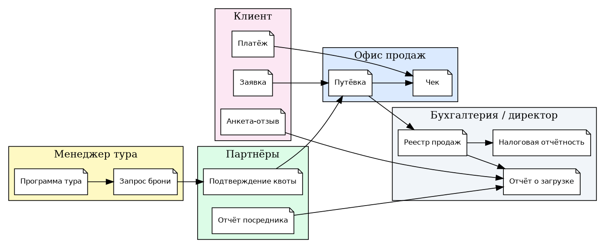
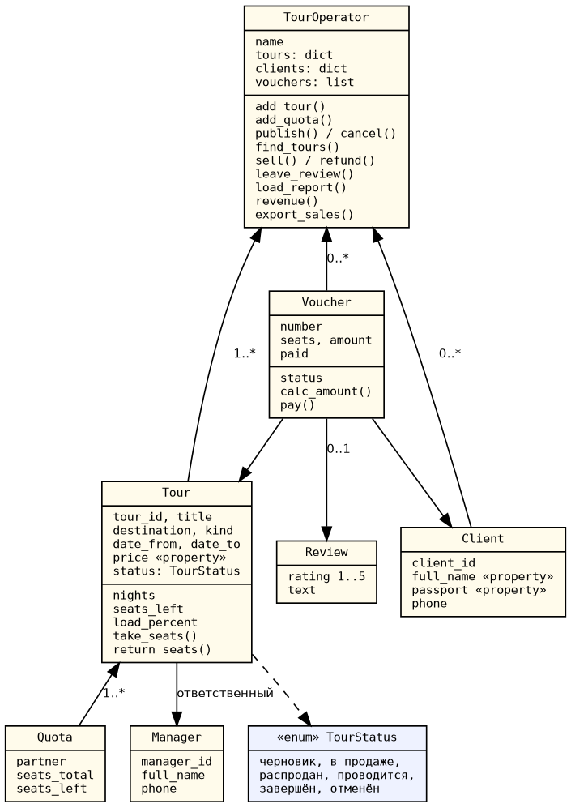

# Практическая работа №4. Объектно-ориентированное проектирование

Предметная область — туроператор (ПР №1), ИС «ТурОфис».

## 1. Анализ предметной области

Объект автоматизации — офис туроператора: менеджеры туров формируют туры и
бронируют квоты мест у партнёров, менеджеры по продажам оформляют путёвки
клиентам, бухгалтерия контролирует оплаты, директор анализирует загрузку и отзывы.

## 2. Функции предметной области

| № | Функция | Реализация в классах |
|---|---------|----------------------|
| 1 | Формирование тура | `TourOperator.add_tour`, `Tour.set_dates`, `Tour.price` |
| 2 | Бронирование квот | `TourOperator.add_quota`, `Quota` |
| 3 | Публикация / отмена тура | `TourOperator.publish`, `cancel` |
| 4 | Поиск тура | `TourOperator.find_tours` |
| 5 | Регистрация клиента | `TourOperator.client_by_passport`, `Client.passport` |
| 6 | Оформление путёвки | `TourOperator.sell`, `Tour.take_seats`, `Voucher.calc_amount` |
| 7 | Возврат путёвки | `TourOperator.refund`, `Tour.return_seats` |
| 8 | Оплата | `Voucher.pay`, `Voucher.status` |
| 9 | Отзыв | `TourOperator.leave_review`, `Review` |
| 10 | Отчёты и экспорт | `load_report`, `revenue`, `avg_rating`, `export_sales` |

## 3. Схема документопотока

## 4. Сущности, атрибуты и связи

| Сущность | Ключевые атрибуты | Связи |
|----------|-------------------|-------|
| Manager | manager_id, full_name, phone | ведёт 0..* туров |
| Tour | tour_id, title, destination, kind, даты, price, status | 1..* Quota; 0..* Voucher |
| Quota | partner, seats_total, seats_left | принадлежит 1 туру |
| Client | client_id, full_name, passport, phone | 0..* Voucher |
| Voucher | number, seats, amount, paid | 1 Tour, 1 Client, 0..1 Review |
| Review | rating, text | 1 Voucher |

## 5. Концептуальная (объектная) модель

Принципы ООП в модели:
- **инкапсуляция** — цена, паспорт, ФИО хранятся в закрытых полях
  (`_price`, `_passport`) и меняются только через свойства с проверкой
  (аналог Property Get/Let из примера на VB);
- **композиция** — тур владеет своими квотами, оператор — турами и путёвками;
- **полиморфизм состояний** — `Voucher.status` вычисляется по сумме оплаты,
  `TourStatus` — перечисление вместо «магических» строк.

## 6. Входные и выходные данные

| Входные | Формат |
|---------|--------|
| Карточка тура | код, название, направление, вид, даты, цена, менеджер |
| Квота | партнёр, число мест > 0 |
| Заявка клиента | ФИО (≥ 2 слов), паспорт «1234 567890», число мест |
| Платёж | сумма > 0, не больше остатка долга |
| Отзыв | оценка 1–5, текст |

| Выходные | Формат |
|----------|--------|
| Путёвка | номер `V-ГГГГ-NNNN`, сумма с учётом скидки 5 % от 4 мест |
| Отчёт о загрузке | тур, продано/всего, %, оценка «высокая / нужна реклама» |
| Выручка, средняя оценка | число |
| Реестр продаж | CSV `;`, UTF-8 |

## 7. Программная реализация

- `turofis/models.py` — классы предметной области;
- `turofis/operator.py` — сервисный класс `TourOperator`;
- `turofis/demo.py` — сценарий (запуск: `cd practice_1-4 && python -m turofis.demo`);
- `turofis/test_turofis.py` — 8 тестов (`python -m unittest turofis.test_turofis`).
